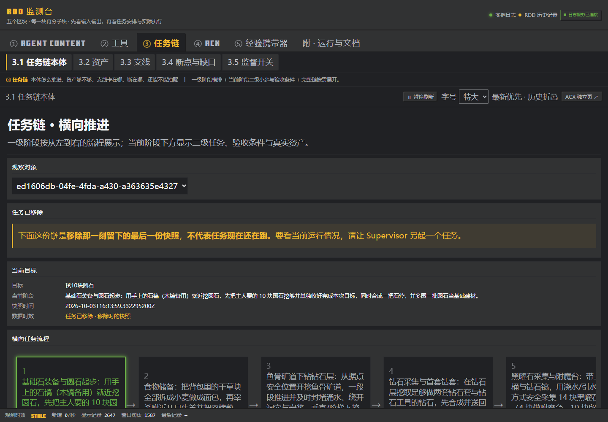

# RDD 自编译工作台 · rdd-restart-doer

> 一套围绕 **Numen（住在 Minecraft 里的 AI 同伴）** 的 **自编译 / 自验证工程闭环**。
> AI 在这里改源码 → 编译成 jar → 部署进游戏 → 真正进游戏驱动它干活 → 从监测台读证据判定成败。
> **源码本体不在本仓**，在套娃仓库 `minecraft-numen`（见 [仓库索引](#二--仓库索引套娃仓库)）；本仓放**流程层**：阶段状态机、门禁、外脑池、编排脚本、文档索引。

<p>
  
</p>

---

## 一 · 这是什么，能干什么

它解决的是「**AI 改了代码，怎么证明真的有用**」这件事。不是编译过就算数，而是：

```
改源码 → 编译 jar → 部署到 mods → 起游戏 → 用 MCP 驱动游戏里的同伴 → 从监测台读真实事件 → 判定
```

这条链里每一步都有机器判据，且有几条硬门禁（编译成功 ≠ 行为成功；MCP 回执 `success` ≠ 世界真变了）。
三份规则/资产真源在本仓之外，见 [知识库分工](#五--知识库与文档都放哪)。

---

## 二 · 仓库索引（套娃仓库）

外层工作区 `.gitignore` 排掉了 5 个内层仓库（避免只存成 gitlink 指针），**外层 git 看不见内层改动**。
跨仓库对账统一看只读面板：

```powershell
node stager\bin\repo-status.js
```

| 仓库 | 路径 | 角色 | 远程 | 分支/状态 |
|---|---|---|---|---|
| **rdd-restart-doer** | `D:\rdd\workspace` | 外层：流程层（stager / 门禁 / 外脑池 / 编排脚本） | `nuomi2422/rdd-restart-doer`（private） | `master` |
| **minecraft-numen** | `minecraft-numen\` | ★ **源码真源**：全部游戏代码（Java / Gradle 9.2 / JDK 21 / NeoForge 1.21.1） | `origin` = `Dwinovo/minecraft-numen`（上游）；`backup` = `nuomi2422/minecraft-numen`（我们的 fork） | `redline-1` |
| **ai-bridge** | `rdd-selfcompile\ai-bridge\` | 浏览器外脑桥（MCP 9527 → Chrome 扩展 → 网页 AI） | `origin` = `SoulChildTc/ai-bridge`；`backup` = `nuomi2422/ai-bridge-backup` | `main` |
| **rdd-monitor-publish-20260913** | `rdd-monitor-publish-20260913\` | ★ **监测台 live 副本**（只读观测，端口 8776） | `origin` = `Asumi-Nishiki/TouhouLittleMaid-HeartPact`；`backup` = `nuomi2422/heartpact-automation-backup` | `codex/rdd-monitor-publish-20260913` |
| **mc-openclaw-controller** | `mc-openclaw-controller\` | 客户端键鼠/感知控制器（8080），**已弃用留档**但运行时仍是依赖 | `origin` = `nuomi2422/minecraft-openclaw-controller-archive`；`upstream` = `fangbm/Minecraft-OpenClaw-Controller` | `main` |
| **voyager** | `voyager\` | 纯参考，只借鉴不搬代码 | `MineDojo/Voyager` | `main`（浅克隆） |

**分工一句话**：`minecraft-numen` 是唯一的代码真源；外层只管「流程与门禁」；监测台只读；`ai-bridge` 提供网页外脑。

---

## 三 · 怎么自动进游戏验证（外围工作台）

### 3.1 单轮闭环（主入口）

```powershell
& "D:\rdd\workspace\rdd-selfcompile\scripts\run-mutation.ps1" -Requirement "<需求>" -Module <模块>
```

编排器依次跑：`new-mutation → build-jar（编译+打包） → deploy（部署 mods） → launch-mc（起游戏） → mcp-drive（驱动） → verify（读监测台判定）`。
常用开关：`-SkipLaunch -SkipMcp`（只编译+部署）、`-Module plugins:rdd`（改哪个模块）、`-AutoStopMinutes 120`。

> ⚠️ **改执行层（`core/common` 的类）必须 `-Module core:neoforge`**，默认模块盖不到。
> **一个 mutation 只放一个 jar**（`deploy.ps1` 取 jars 目录第一个）→ 多模块要多次跑。

### 3.2 进游戏 / 出游戏两段门禁

```powershell
node "D:\rdd\harness\rdd-harness\bin\harness-gate.js" preflight  --since <今天> --keyword <模块> --head <HEAD>
#   ↑ 进游戏前：读《进游戏前必读-游戏内能力清单.md》（说话/建伙伴/停内脑/视觉/追踪/相机/飞行/看监测台）
node "D:\rdd\harness\rdd-harness\bin\harness-gate.js" postflight --since <今天> --keyword <模块> --head <HEAD>
#   ↑ 出游戏后：查「写记录 + 写文档 + 灌记忆图谱 + 产物真的落地 + 时间锁更新 + 编号登记 + 游戏已关」
```

### 3.3 运行时链路（端口）

| 组件 | 位置 | 说明 |
|---|---|---|
| **OpenClaw 控制器** | `mc-openclaw-controller\scripts\server.js` → 8080 | **必须先于游戏起**，否则这一轮游戏连不上 |
| **游戏实例 live** | `D:\rdd\mc\The Best of Twilight Forest`（存档 `live`） | 命令行参数名写 `-Instance gpt`，那是**参数名**不是实例名 |
| **Numen MCP** | `127.0.0.1:8765` | 驱动同伴的唯一正道，`mcp-call.js` / `numen-mcp.js` |
| **监测台** | `http://127.0.0.1:8776/` → `rdd-monitor-publish-20260913\monitoring-station\server.mjs` | 只读观测；埋点 `config\numen\monitor\rdd.jsonl`（干净 UTF-8） |

驱动 / 观测常用命令：

```powershell
node rdd-selfcompile\scripts\mcp-call.js list_companions          # 进游戏第一件事：确认真实同伴名
node rdd-selfcompile\scripts\mcp-call.js say <同伴名> '<json>'     # 和游戏内 AI 说话
node rdd-selfcompile\scripts\numen-mcp.js status <同伴名>          # 唯一机器可读 JSON 的姿势
node rdd-selfcompile\scripts\mc-watch.js                          # 退游戏前留一屏现场
```

> ⚠️ 判中文功能查 **监测台 `rdd.jsonl`**（干净 UTF-8）；游戏 `latest.log` 是 **GBK**，用中文 grep 是假阴性。
> ⚠️ 回执 `success:true` **只说明 handler 没抛异常**，不等于东西真存在/真生效 —— 落盘/生效要自己查。

---

## 四 · 游戏内「实机已验证」能做到的事

> 依据：`rdd-docs\rdd架构\` 下的实机验证记录（下文标注日期与出处）。**只列有实机回执/监测台证据的**，
> 未验证的一并列出，避免把「写完了」当成「验证了」。

### 4.1 世界观测 V1（2026-10-18 实机验收，11/11 通过）

来源：`世界观测V1-实机验证-20261018.md`。工具 `world_state`（live 实例，同伴 ACX）。

| 能力 | 结果 |
|---|---|
| 读不扫描 | `read` 已有观测 → `present:true`，**没有偷偷扫描**；未采集范围 → `present:false / UNKNOWN` |
| 新鲜度 | `age_ms>TTL` 正确判 `STALE`；重启后载入的观测判 `HISTORICAL`（附文案「内容无法确认，请刷新」） |
| 有界实体计数 | `refresh entities` 绕盒 → `count / scanned_columns / skipped_columns / COMPLETE` |
| 预算明确拒绝 | 64000 格盒 → `success:false, reason:BUDGET_EXCEEDED`（不静默） |
| 按世界隔离落盘 | `config\numen\worldstate\observations.json` 带 `worldId`，`revision` 单调 |
| 监测事件 | `worldstate.jsonl` 记 `refresh / read / refresh_failed`，带 topic/dimension/coverage/reason |
| 重启保留历史 → 刷新回当前 | `HISTORICAL` → `CURRENT, can_prove_absence:true` |

### 4.2 任务链 / 学习闭环（2026-10-05 ~ 10-06 实机，live 实例）

来源：`第二批实机验收-整合清单-20261005.md`、`第三批-live验证-ACX村庄路线闭环-20261006.md`。

| 能力 | 状态 |
|---|---|
| 教 → 存 → 浮现：`experience_learn` 落库、`<experience>` 块每轮注入 | ✅ 实机验证 |
| **内脑自己写结构化经验**（七字段填 6 个、priority 90） | ✅ 观测到（`expmem.jsonl` 12:55:30 `learned`） |
| 目标分解 / 重规划 / `requirements_met` / `goal_completed` | ✅ 首次观测到 `requirements_met`（13:45）与整级 `goal_completed`（13:49） |
| 容器 / 熔炉操作：`inspect_gui` + `transfer` + `close_gui`，`set_timer` 管等待 | ✅ 实机 |
| **死亡恢复 + 捡包**：跑回死亡点把 104 原铁全捡回 | ✅ 真机成立 |
| 自主 COUNTER/REJECT 不可行子任务、自设定时器、加载技能 | ✅ 实机自证 |

### 4.3 自编译闭环（期 2，2026-08-31）

来源：`rdd-selfcompile\README.md`。AI 生成 `RddWhereamiTool.java` → `gen-code` 落盘登记 → 编译打包 → 部署重启 →
`mcp` 真实调用 `rdd_whereami`：

```json
{"dimension":"minecraft:overworld","x":165,"y":64,"z":-128,"on_ground":true}
```

### 4.4 尚未验证 / 已知盲点（照实列）

| 项 | 状态 |
|---|---|
| AC（自主控制脚本）**自写**能力 | ❌ 未验证（第三批未走到那一步） |
| 新经验「按任务召回 → 采用 → 改变重规划」 | ❌ 存储✓、浮现✓、**采用未证明** |
| 农田 AC / 村民交易点 / 自动挖铁 AC | ❌ 未取得验收证据 |
| 放置选位（站原地反复右键）、不躲苦力怕、爆炸掉落不主动捡 | ⚠️ 已记录盲点 8 项，见 `第三批-…-20261006.md` 第五节 |
| `world_state` 之外的世界事实扩展（ABC 三组） | ⚠️ 施工中 |

---

## 五 · 知识库与文档都放哪

| 目录 | 谁用 | 装什么 |
|---|---|---|
| `D:\rdd\docs\rdd-docs\rdd存放\` | **用户** | 你要看/要用/要点的东西 |
| `D:\rdd\docs\rdd-docs\rdd架构\` | AI | 设计 + 规范 + 叙事的真源（70 份编号文档） |
| `D:\rdd\harness\rdd-harness\` | AI | 工具注册表 / 编程规范 / 门禁 / 时间锁 / stage 流 |
| `rdd-selfcompile\report\` | AI | 外脑审稿原文（W 池回复也归档到这） |
| `rdd-monitor-publish-20260913\monitoring-station\` | AI | 监测台源码（8776） |

> 想解决 X 该读哪份 → `rdd架构\50-按主题导航.md`；那天做了什么 → `rdd架构\51-研发叙事时间线.md`。
> **总结 / 复盘 / 经验文档一律写 `rdd-docs\rdd架构\`，不写进 harness 目录。**

---

## 六 · GitHub 直连（已可绕过梯子）

2026-10-18 实测：本机 **直连 GitHub 完全可用**，不再需要代理。

| 探测 | 结果 |
|---|---|
| 直连 `github.com:443` / `api.github.com:443` / `raw.githubusercontent.com:443` | ✅ TCP 可达 |
| 本地代理 `127.0.0.1:7897` | ❌ 未监听（梯子已下线） |
| `gh auth status` | ✅ 已登录（`repo` scope，可推） |
| `git fetch origin` | ✅ 直连成功 |

改了什么（原来每次联网构建/推送都失败在死代理上）：

- `~/.gitconfig`：为 `https://github.com/` **单独置空代理**（`http.<url>.proxy =`），GitHub 走直连，其余保持原样。
- `D:\rdd\.gradle\gradle.properties`：注释掉 4 行 `systemProp.*.proxy*`（原本强制走 7897）。
- `rdd-selfcompile\scripts\config.ps1`：`GRADLE_OPTS` 里的代理改为**可选**（设 `RDD_GRADLE_PROXY=<端口>` 才注入，默认空 = 直连）。

> 若将来代理恢复且直连被墙：把上面三处反向改回，或临时 `$env:RDD_GRADLE_PROXY=7897` 即可。

---

## 七 · 离线编译包（解压即编译）

目的：把「源码 + 全部 Gradle 缓存（含 Minecraft 反编译工件）+ JDK + Gradle 发行版」打成一个包，
解压后 **不联网** 就能直接 `gradle --offline` 编译出 jar —— 跳过「先联网下载 MC 工件 / moddev / loom 缓存」这一步。

生成与恢复脚本在 `packaging\`（见 `packaging\README.md`）。产物布局：

```text
numen-offline-bundle/
├── build-offline.cmd        # 解压后双击/命令行跑：设好 GRADLE_USER_HOME/JAVA_HOME → gradle --offline
├── README-OFFLINE.md
├── src\                     # minecraft-numen 源码（去掉 .git / build / runs）
├── gradle-home\             # GRADLE_USER_HOME 快照（caches/{fabric-loom,neoformruntime,modules-2}）
├── gradle-9.2.0\            # 离线 Gradle 发行版
└── jdk\jdk-21.0.11+10\      # 便携 JDK 21
```

判据（全过才算「能发出去」）：断网 → `build-offline.cmd clean assemble` 退出码 0；
日志里 `Downloading / Could not resolve / Failed to setup Minecraft / No cached version` **均为 0 次**。

---

## 八 · 常见坑（摘要，全文见 `AGENTS.md`）

- `git add -A` **禁用** —— 本工作区常有并行会话改同一仓库，**精确 add**，`git commit -F msg.txt`。
- **源码改了 ≠ 运行时生效**（隔着编译→部署 jar→重启游戏）：`node rdd-selfcompile\scripts\verify-tools\check-runtime-deployment.js`（退出码 2 = 源码领先 jar）。
- `.ps1` 必须写 **UTF-8 BOM**（PS 5.1 读无 BOM 的 UTF-8 会乱码）；`node -e "…"` 内联会被 PS 拆坏 → 一律写 `.js`。
- 6 个套娃 git 仓库，外层 `.gitignore` 排掉内层 → 对账看 `node stager\bin\repo-status.js`，别只看外层 `git log`。
